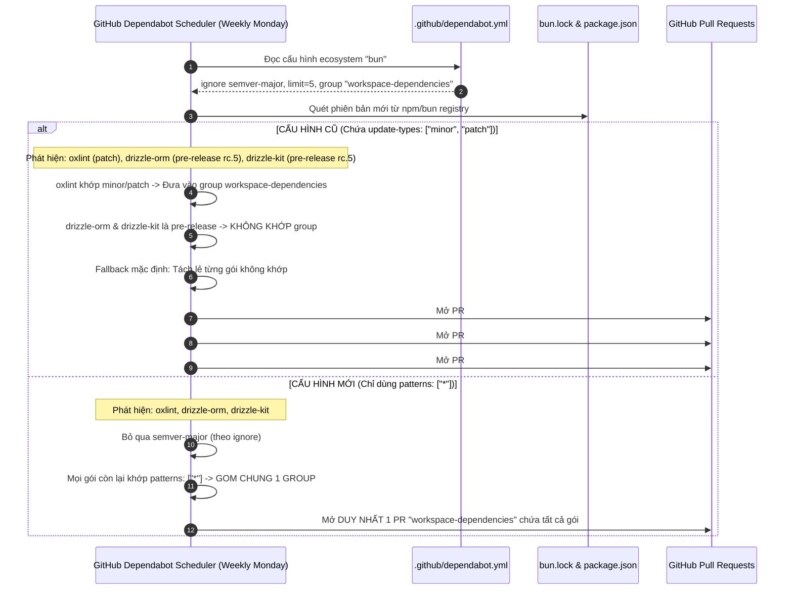

# Bản Thiết Kế Kiến Trúc & Hướng Dẫn Triển Khai: Issue #67

Tài liệu hướng dẫn triển khai 5 bước chi tiết cho **Issue #67: fix(ci): consolidate weekly dependabot updates into single pull request**, tuân thủ tiêu chuẩn kỹ thuật monorepo của GreenRoots Farm và chỉ đạo nghiệp vụ: **cho phép cập nhật Drizzle, không pin cứng, giữ nguyên `open-pull-requests-limit: 5`**.

---

### Bước 1: Khởi tạo Nhánh & Khóa Scope

#### 1. Mục tiêu & Scope của Issue #67

- **Issue**: [#67: fix(ci): consolidate weekly dependabot updates into single pull request](https://github.com/ngxccc/greenroots-farm/issues/67)
- **Mức độ ưu tiên**: `P2` (Tooling & CI Maintenance).
- **Scope cốt lõi (Outcome)**:
  Dependabot gom toàn bộ các cập nhật non-major của hệ sinh thái Bun workspaces vào **một PR định kỳ duy nhất** mỗi tuần (`workspace-dependencies`), chấm dứt triệt để tình trạng spam nhiều PR riêng lẻ do các gói pre-release / commit-hash (như Drizzle ORM/Kit) bị loại khỏi group.
- **Ràng buộc nghiệp vụ (Constraints)**:
  1. Vẫn cho phép nâng cấp phiên bản mới của `drizzle-orm` và `drizzle-kit`, không thêm rule pin cứng hay ignore vĩnh viễn.
  2. Giữ nguyên `open-pull-requests-limit: 5` cho ecosystem `bun`.
- **Acceptance Criteria**:
  - [x] Loại bỏ `update-types: ["minor", "patch"]` khỏi group `workspace-dependencies` trong `.github/dependabot.yml`.
  - [x] Giữ nguyên `open-pull-requests-limit: 5`.
  - [x] Không thêm quy tắc ignore hay pin cố định cho `drizzle-orm` / `drizzle-kit`.
  - [x] Toàn bộ quy trình `bun run format && bun run check` vượt qua không có lỗi.

#### 2. Kiểm tra phụ thuộc (Dependencies & Blockers)

- **`blocked_by`**: Trống (`[]`). Issue độc lập về cấu hình CI/CD, có thể triển khai ngay.
- **`blocking`**: Trống (`[]`). Không chặn luồng phát triển tính năng khác.

#### 3. Trạng thái Git & Tách nhánh

Thực hiện trên nhánh chuyên biệt theo chuẩn Git Flow (`docs/standards/git-flow-and-pr-matrix.md`):

```bash
git checkout main && git pull origin main
git checkout -b fix/dependabot-pr-spam
```

---

### Bước 2: Mổ xẻ Luồng Nghiệp vụ & Bất biến (Business Invariants)

#### 1. Luồng dữ liệu & Chu trình hoạt động của Dependabot (Data Flow)

Biểu đồ so sánh luồng xử lý trước và sau khi tối ưu hóa cấu hình:



#### 2. Bảng các bất biến hệ thống (System Invariants)

| Mã Invariant  | Tên Bất Biến                           | Mô Tả Chi Tiết & Hành Vi Cưỡng Chế                                                                                                                                                                 |
| :------------ | :------------------------------------- | :------------------------------------------------------------------------------------------------------------------------------------------------------------------------------------------------- |
| **INV-DEP-1** | **Unified Grouping Invariant**         | Mọi bản nâng cấp trong Bun ecosystem không thuộc diện `semver-major` bắt buộc phải được gom vào đúng 1 PR hàng tuần (`workspace-dependencies`). Không để lọt bất kỳ package nào ra ngoài mở PR lẻ. |
| **INV-DEP-2** | **Major Isolation Invariant**          | Các cập nhật breaking change lớn (`version-update:semver-major`) phải luôn bị ignore tự động, đòi hỏi kỹ sư chủ động nâng cấp thủ công và đánh giá tác động.                                       |
| **INV-DEP-3** | **Unrestricted Pre-release Invariant** | Không áp đặt ignore hay pin cứng cho các package đang thử nghiệm/pre-release (như Drizzle v1-rc) khi nghiệp vụ yêu cầu liên tục cập nhật theo upstream.                                            |
| **INV-DEP-4** | **Concurrency Boundary Invariant**     | `open-pull-requests-limit: 5` đóng vai trò chốt chặn an toàn cho toàn bộ ecosystem, không bao giờ được phép bị lạm dụng để mở nhiều PR trùng lặp cho cùng một nhóm thư viện.                       |

#### 3. Bảng phân loại lỗi & cơ chế xử lý khi PR tổng hợp gặp sự cố

| Hiện tượng                     | Nguyên nhân gốc                                  | Hậu quả CI                      | Cơ chế xử lý                                                                                           |
| :----------------------------- | :----------------------------------------------- | :------------------------------ | :----------------------------------------------------------------------------------------------------- |
| **Pre-release Breaking API**   | Drizzle ORM đổi chữ ký hàm hoặc relational query | `CI/API` báo đỏ                 | Kỹ sư review PR gộp, cherry-pick sửa adapter hoặc comment `@dependabot ignore` nếu bản RC chưa ổn định |
| **Schema Generation Mismatch** | Drizzle Kit sinh mã SQL snapshot mới             | `CI/Migrations and Seed` báo đỏ | Chạy `bun run db:generate` cục bộ để commit bổ sung migration đồng bộ trước khi merge                  |
| **Duplicate Individual PRs**   | Dependabot group filter quá chặt loại trừ gói    | Spam nhiều PR song song         | Loại bỏ `update-types` trong group, để `patterns: ["*"]` gom triệt để                                  |

---

### Bước 3: Triển khai Lát cắt Cấu hình (Slice-by-Slice)

#### Lát cắt duy nhất: Chuẩn hóa Grouping trong `.github/dependabot.yml`

1. **Vấn đề kỹ thuật**:
   GitHub Dependabot quy định: nếu một dependency có bản update nhưng không khớp với điều kiện lọc (`update-types: ["minor", "patch"]`) của group, nó sẽ bị đẩy ra ngoài và mở PR riêng lẻ.
2. **Giải pháp**:
   Loại bỏ hoàn toàn dòng `update-types: ["minor", "patch"]` bên trong block `workspace-dependencies`. Vì block `ignore` phía trên đã loại trừ `semver-major`, việc để `patterns: ["*"]` độc lập sẽ đảm bảo toàn bộ các bản update còn lại (minor, patch, pre-release) đều được nhóm vào chung 1 PR.

```yaml
# .github/dependabot.yml (Đoạn cấu hình sau chỉnh sửa)
version: 2
updates:
  # ── Bun Workspace Dependencies ──
  - package-ecosystem: "bun"
    directory: "/"
    schedule:
      interval: "weekly"
      day: "monday"
    open-pull-requests-limit: 5
    labels:
      - dependencies
      - type:chore
    commit-message:
      prefix: "chore(deps)"
    ignore:
      - dependency-name: "*"
        update-types: ["version-update:semver-major"]
    groups:
      workspace-dependencies:
        patterns: ["*"]

  # ── GitHub Actions Workflows & Composite Actions ──
  - package-ecosystem: "github-actions"
    directory: "/"
...
```

---

### Bước 4: Kiểm tra & Xác minh (Verification)

1. **Xác minh cú pháp YAML**:
   Đảm bảo thụt lề chuẩn 2 spaces, không có tab, schema Dependabot v2 hợp lệ.
2. **Xác minh Monorepo Quality Gate**:
   Chạy toàn bộ bộ test và linter tĩnh để chắc chắn không gây tác động phụ:
   ```bash
   bun run format
   bun run check
   ```
   - Kết quả: `oxfmt` quét 250 files thành công.
   - Kết quả: `tsc --noEmit` và `oxlint --type-aware` sạch 100% trên cả 6 workspaces (`api`, `storefront`, `backoffice`, `shared`, `ui`, `scripts`).

---

### Bước 5: Chạy Quality Gate & Mở Pull Request

#### 1. Bộ lệnh kiểm tra trước khi commit

```bash
bun run check
git status -s && git diff
```

#### 2. Kế hoạch Commit nguyên tử (Conventional Commits)

- **Commit**: `fix(ci): include all non-major dependencies in workspace group`
  - Remove `update-types: ["minor", "patch"]` from `workspace-dependencies` group in `.github/dependabot.yml`.
  - Ensure all non-major updates (including pre-releases like Drizzle) are bundled into a single weekly grouped PR.
  - Relates to: #67

#### 3. Bản thảo Pull Request chuẩn 5 phần

```markdown
## Summary

Fix Dependabot configuration to group all non-major workspace dependency updates (including pre-releases such as Drizzle ORM/Kit) into a single weekly pull request, eliminating PR spam.

## Changes

- Remove `update-types: ["minor", "patch"]` restriction from `workspace-dependencies` group in `.github/dependabot.yml`.
- Retain `open-pull-requests-limit: 5` ceiling and global `version-update:semver-major` ignore policy.

## Testing

- `bun run format`: All files verified cleanly with oxfmt.
- `bun run check`: Full workspace type-checking and type-aware oxlint passed with 0 errors.

## Risk / Rollback

- Risk: Low. Scoped strictly to CI dependency automation.
- Rollback: Revert the commit to restore individual PR behavior if needed.

## Linked Issues

- Resolves: #67
```
